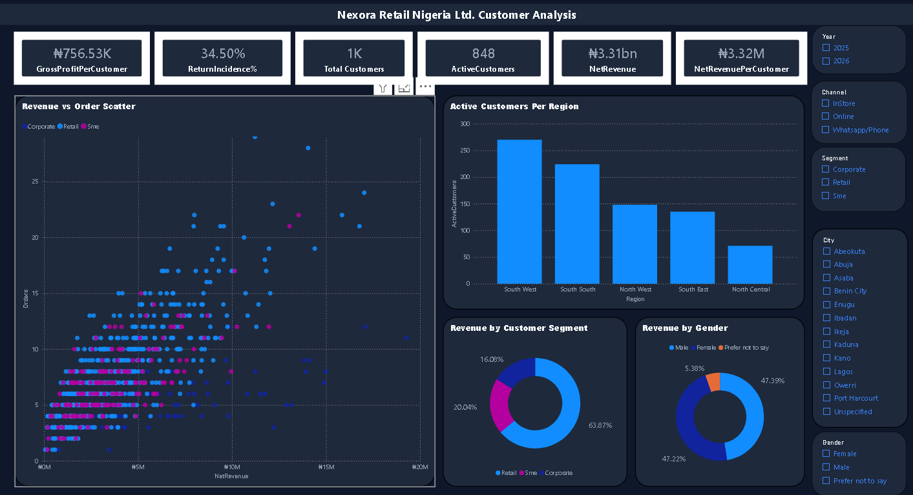
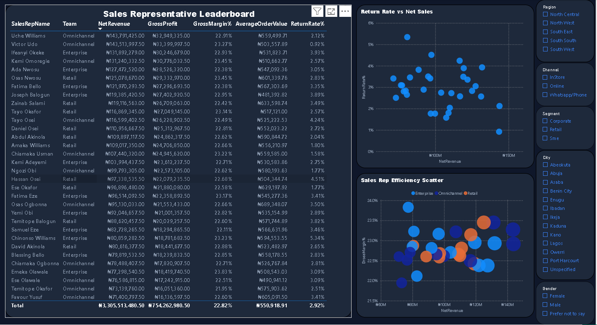

# Nexora Retail Nigeria Ltd. — Power BI Portfolio Case Study

A commercial performance analysis built in Power BI for **January 2025–June 2026**. The project examines sales-target attainment, revenue retained after refunds, margin, returns, store performance, customer behavior, and channel mix.

> **Portfolio note:** This repository contains dashboard screenshots, the Power BI project file, and supporting documentation. GitHub displays these materials but does not host the report as an interactive Power BI web experience. Open the `.pbix` file in Power BI Desktop to explore the report.

## Business question

How did Nexora perform against its sales target, where did performance differ across the business, and which patterns warrant further investigation?

## Key findings

- **Target gap:** overall target achievement was **96.90%**, a 3.10% shortfall against the sales target.
- **Like-for-like period comparison:** H1 2026 Net Sales were **1.30% below H1 2025** and Net Revenue was down 1.21%, while Gross Profit was approximately flat (+0.04%). Gross margin rose from 22.60% to 22.89%.
- **Store variation:** Ikeja (102.80%), Abuja (102.64%), and Victoria Island (101.25%) exceeded target. Kano had the lowest target achievement (86.48%) and the highest store unit return rate (4.06%). These differences identify where to investigate; they do not establish why the gaps occurred.
- **Discount and margin:** observed gross margin declined across higher discount bands. This is an association in the available data, not proof that discounts caused the decline or increased sales volume.
- **Channel signal:** WhatsApp/Phone had an average order value of about **₦648,000**, a 2.36% unit return rate, and approximately 12.4% of revenue. This warrants further testing but does not prove scalable or incremental profit.
- **Recorded return reasons:** “Defective” was the largest recorded category (194 units; about 34.3% of returned units). The label does not establish the operational root cause.

These findings are descriptive signals for prioritising further analysis, not causal conclusions.

## Dashboard preview

The screenshots below are displayed at approximately **80% of the previous full-width presentation**. Open an image in GitHub to inspect its details at full resolution.

### Executive overview

  

### Customer analysis

  

### Sales representative performance

  

### Time analysis

  

### Data model

  

## Selected results

| Metric | Result | Definition |
|---|---:|---|
| Gross Sales | ₦3.618B | Sales value before discounts |
| Net Sales | ₦3.4439B | Gross Sales less discount value |
| Net Revenue | ₦3.3055B | Net Sales less refunds |
| Gross Profit | ₦754.26M | Net Revenue less Net COGS |
| Gross Margin | 22.82% | Gross Profit as a share of Net Revenue |
| Target Achievement | 96.90% | Net Sales divided by sales target |

**Metric distinction:** Net Sales, Net Revenue, and Gross Profit are different measures and are not interchangeable.

## Methodology and tools

1. **Prepare data — Power Query:** review data types, standardize categorical values, address missing descriptive fields, and document inferred brand mappings.
2. **Model data:** connect product, customer, store, sales representative, and date dimensions to sales and target facts.
3. **Build measures — DAX:** calculate sales, discounts, refunds, revenue, cost, gross profit, margin, target achievement, returns, time comparisons, and customer segmentation.
4. **Design report pages:** build executive, time, customer, and sales representative analysis pages, supported by a data-model view.
5. **Validate:** check KPI arithmetic, model relationships, date behavior, slicers, drill-through, and report interactions.

## Data quality, QA, and limitations

The QA report dated 14 October 2026 records **47/47 checks passed**: 30 checks were verified against the model/data and 17 manual checks were owner-confirmed. The owner-confirmed checks are not represented as independently reproduced. Passing QA does not mean every source-data limitation has been corrected.

Key limitations:

- 764 sales lines pre-date product launch dates (about ₦351.6M / 10.6% of Net Revenue).
- 285 sales lines pre-date customer signup dates (about ₦89.4M / 2.7% of Net Revenue).
- Three blank product brands were inferred from product-name patterns; the mappings are not source-confirmed.
- 12 customer records have missing City values and 12 sales lines have missing PaymentMethod values; both are represented as Unspecified.
- 314 customer-name values are duplicated. Use CustomerID for customer-level analysis rather than treating names as unique identifiers.
- The dataset covers January 2025–June 2026 and contains no 2024 data, so 2025 year-over-year analysis is unavailable.
- Targets are defined at store/month level, not for every day or every product, representative, channel, customer, or city. Some target measures are intentionally blank under incompatible slicer contexts.
- Customer segment thresholds vary with the selected date context.
- Return-reason labels, discount-band margin differences, channel metrics, and store gaps are descriptive signals; they do not prove root causes or causal effects.
- Refresh may depend on a local Google Drive for Desktop path and may require environment-specific changes on another computer.

For full detail, read the [Data Quality and Limitations note](documentation/data-quality-and-limitations.md), the [QA report](documentation/qa-report-2026-10-14.pdf), and the [documentation index](documentation/README.md).

## Repository contents and access

- **Power BI report:** [Open the report folder](report/) — download the `.pbix` file and open it in Power BI Desktop.
- **Screenshots:** [View dashboard and model images](screenshots/).
- **QA report:** [Read the QA report (PDF)](documentation/qa-report-2026-10-14.pdf).
- **Data quality:** [Read the full data-quality note (Markdown)](documentation/data-quality-and-limitations.md) or [Word version](documentation/data-quality-and-limitations.docx).
- **Documentation index:** [Browse supporting documentation](documentation/README.md).

## Tools and skills demonstrated

- Power Query data preparation
- Dimensional modeling and star-schema design
- DAX measures and time comparisons
- KPI validation and data-quality documentation
- Interactive dashboard design and business interpretation

## Scope and responsible interpretation

This portfolio case study uses the dataset and reporting model in this repository. Results are decision-support signals for further investigation, not proof of causality or audited financial statements. Before operational use, validate source lifecycle dates, inferred brands, customer identity, and refresh configuration.
