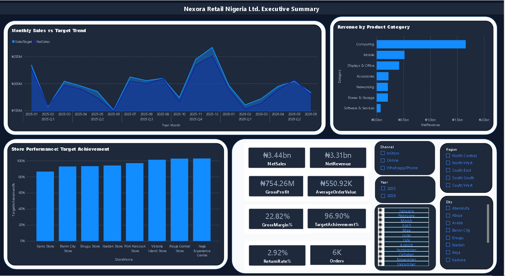
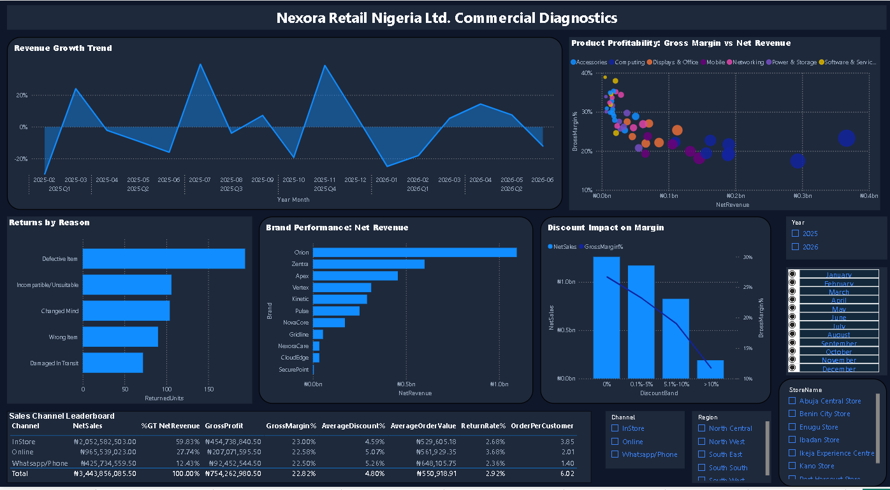
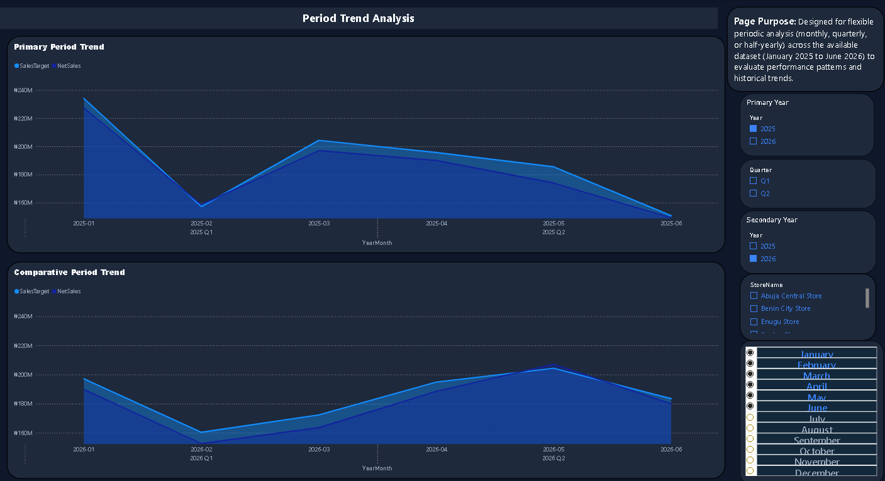
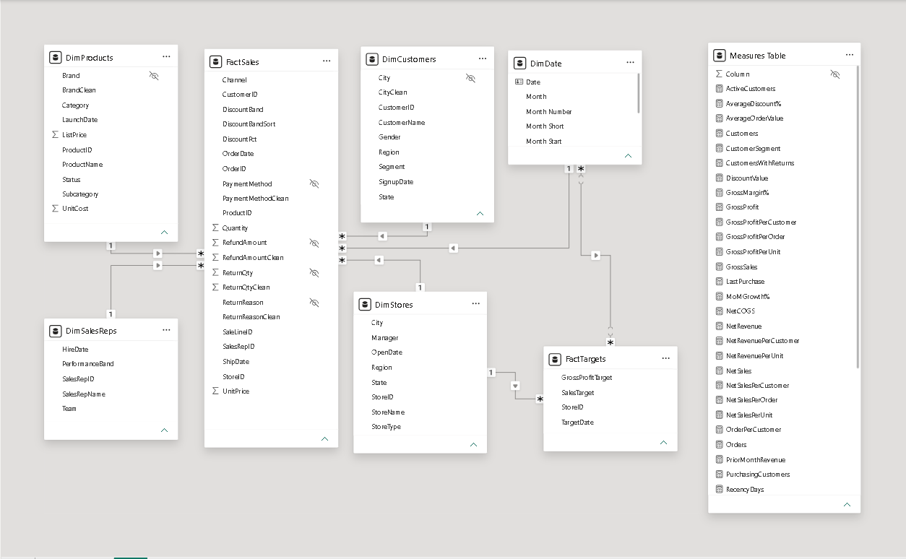

# Nexora Retail Nigeria Ltd. — Power BI Portfolio Case Study

A commercial performance analysis built in Power BI for **January 2025–June 2026**, examining sales-target attainment, revenue after refunds, profitability, store performance, customer behavior, returns, and channel mix.

> **Portfolio note:** This repository contains dashboard screenshots, the Power BI project file, and supporting documentation. GitHub does not host the report as an interactive Power BI web experience. Download the .pbix file and open it in Power BI Desktop to explore the report.

## Executive summary

Nexora Retail Nigeria Ltd.'s commercial performance was close to, but below, its sales target during the January 2025–June 2026 reporting period. Overall target achievement was **96.90%**, leaving a 3.10% gap against the target.

The first-half comparison provides a more nuanced picture. **H1 2026 Net Sales declined 1.30% versus H1 2025 and Net Revenue declined 1.21%, while Gross Profit remained approximately flat, increasing 0.04%.** Gross margin rose from 22.60% to 22.89%, an improvement of 0.29 percentage points. This indicates relative margin resilience despite lower sales and revenue, although further analysis is needed to determine what drove the change.

Performance was not uniform across the business. Ikeja, Abuja, and Victoria Island exceeded their sales targets, while Kano recorded the lowest target achievement and the highest store unit return rate. These differences provide a basis for prioritising store-level investigation, but they do not establish the causes of underperformance or returns.

Three additional signals merit investigation: gross margin was lower across higher discount bands; WhatsApp/Phone recorded a relatively high average order value; and “Defective” was the most frequently recorded return-reason category. These patterns can guide follow-up analysis, but the available data does not establish causality, incremental profitability, or operational root causes.

**Business implication:** Nexora should investigate the drivers of the target gap, determine whether margin resilience is sustainable, and prioritise store performance and return patterns for further review. Any operational changes should be evaluated against defined performance measures rather than assumed to be effective from descriptive results alone.

## Business questions

This analysis examines four questions:

1. **Commercial performance:** How closely did Nexora meet its sales target, and how did sales, revenue, and profitability change over time?
2. **Performance variation:** Which stores and sales channels show results that warrant closer investigation?
3. **Margin and returns:** How do discount bands and recorded return patterns relate to commercial performance?
4. **Decision priorities:** Which findings provide the strongest basis for further analysis, and what additional evidence is needed before acting?

## Key findings

### 1. Sales target attainment remains below target

Overall target achievement was **96.90%**, representing a 3.10% shortfall against the sales target. This establishes the overall performance gap; further analysis is required to identify the periods and business segments contributing most to it.

### 2. Gross profit remained stable despite lower first-half sales

H1 2026 Net Sales were 1.30% below H1 2025, and Net Revenue declined 1.21%. Gross Profit increased approximately 0.04%, while gross margin rose from 22.60% to 22.89%.

The results show that gross profit was broadly stable despite lower sales and revenue. They do not, by themselves, explain whether this was driven by product mix, discounting, cost movements, or another factor.

### 3. Store performance varies materially

Ikeja achieved 102.80% of target, Abuja 102.64%, and Victoria Island 101.25%. Kano recorded the lowest target achievement at 86.48% and the highest store unit return rate at 4.06%.

These results identify locations for comparative investigation. They do not establish why stores performed differently, and the return rate should be assessed alongside sales volume and return counts.

### 4. Higher discount bands are associated with lower gross margin

Observed gross margin declined across higher discount bands. This association warrants further investigation into discount policy, product mix, and profitability. The analysis does not prove that discounts caused lower margin or generated additional sales volume.

### 5. WhatsApp/Phone shows a channel signal worth testing

WhatsApp/Phone recorded an average order value of approximately **₦648,000**, a 2.36% unit return rate, and approximately 12.4% of revenue.

These metrics make the channel a candidate for deeper analysis. Average order value and revenue share alone do not establish incremental sales, acquisition efficiency, or scalable profit.

### 6. “Defective” is the largest recorded return-reason category

“Defective” accounted for 194 returned units, approximately 34.3% of returned units. This makes it the largest recorded return-reason category in the dataset.

The label describes the recorded reason, not the verified operational root cause. Further investigation would need to examine product, supplier, batch, and return-processing records where available.

## Dashboard preview

The screenshots below are selected portfolio-facing pages. Customer detail tables and drill-through pages are retained for internal validation and investigation, not presented as executive-facing portfolio pages. The screenshots are displayed at approximately 80% width; open an image in GitHub to inspect it at full resolution.

### Executive overview

  

### Commercial diagnostics

  

### Time analysis

  

### Data model

  

## Selected results

| Metric | Result | Definition |
|---|---:|---|
| Gross Sales | ₦3.62B | Sales value before discounts |
| Net Sales | ₦3.44B | Gross Sales less discount value |
| Net Revenue | ₦3.31B | Net Sales less refunds |
| Gross Profit | ₦754.26M | Net Revenue less Net COGS |
| Gross Margin | 22.82% | Gross Profit divided by Net Revenue |
| Average Order Value (AOV) | ₦550.92K | Net Revenue divided by 6,000 orders |
| Target Achievement | 96.90% | Net Sales divided by sales target |

**Metric distinction:** Net Sales, Net Revenue, and Gross Profit are different measures and are not interchangeable. Net Revenue is post-refund revenue; it is the numerator for AOV and the denominator for Gross Margin. Return rates are calculated against units sold. The report's 6,000-order count should be read as orders, not customers.

## Recommended areas for further investigation

The findings suggest four analytical priorities. These are proposed next steps, not claims that the underlying causes have already been established.

1. **Diagnose the target gap.** Break down target achievement by month and store to determine where the largest contribution to the shortfall occurred.
2. **Investigate margin resilience.** Examine product mix, cost movements, and discount patterns to understand how gross profit remained stable as sales declined.
3. **Review store and return differences.** Compare return counts and rates, product categories, and recorded return reasons to identify patterns requiring operational review.
4. **Test channel economics.** Assess order value, return rates, and available cost or acquisition data before making decisions about channel expansion.

## Methodology and tools

1. **Prepare data — Power Query:** review data types, standardise categorical values, address missing descriptive fields, and document inferred brand mappings.
2. **Model data:** connect product, customer, store, sales representative, and date dimensions to sales and target facts; keep source `Segment` (account type / primary-residency classification) distinct from DAX-derived `CustomerSegment` (behavioral interaction tier).
3. **Build measures — DAX:** calculate sales, discounts, refunds, revenue, cost, gross profit, margin, target achievement, returns, time comparisons, and customer segmentation.
4. **Design report pages:** build executive and commercial diagnostic views, with supporting analytical pages. Customer detail tables and drill-through pages are retained for internal testing and investigation rather than highlighted as executive-facing portfolio pages.
5. **Validate:** check KPI arithmetic, model relationships, date behavior, slicers, drill-through, and report interactions.

## Data quality, QA, and limitations

The QA report dated 14 October 2026 records **47/47 checks passed**: 30 checks were verified against the model/data and 17 manual checks were owner-confirmed. The owner-confirmed checks are not represented as independently reproduced. Passing QA does not mean every source-data limitation has been corrected.

Key limitations:

- 764 sales lines pre-date product launch dates (about ₦351.6M / 10.6% of Net Revenue).
- 285 sales lines pre-date customer signup dates (about ₦89.4M / 2.7% of Net Revenue).
- Three blank product brands were inferred from product-name patterns; the mappings are not source-confirmed.
- 12 customer records have missing City values and 12 sales lines have missing PaymentMethod values; both are represented as Unspecified.
- 314 customer-name values are duplicated. Use CustomerID for customer-level analysis rather than treating names as unique identifiers.
- The dataset covers January 2025–June 2026 and contains no 2024 data, so a full-year 2025 year-over-year comparison is unavailable. The H1 2026 vs H1 2025 comparison is a like-for-like six-month comparison, not a full-year comparison.
- Targets are defined at store/month level, not for every day or every product, representative, channel, customer, or city. Some target measures are intentionally blank under incompatible slicer contexts.
- Customer segment thresholds vary with the selected date context.
- Return-reason labels, discount-band margin differences, channel metrics, and store gaps are descriptive signals; they do not prove root causes or causal effects.
- Refresh may depend on a local Google Drive for Desktop path and may require environment-specific changes on another computer.

For full detail, read the [Data Quality and Limitations note](documentation/data-quality-and-limitations.md), the [QA report](documentation/qa-report-2026-10-14.pdf), and the [documentation index](documentation/README.md).

## Source dataset

- **Original raw workbook:** [Nexora_PowerBI_Assessment_Raw_Dataset (WELUP DIGITAL).xlsx](data/Nexora_PowerBI_Assessment_Raw_Dataset%20%28WELUP%20DIGITAL%29.xlsx) — the source workbook supplied for the assessment, before Power Query cleaning and transformation.

## Repository contents and access

- **Power BI report:** [Download the Power BI report](report/Nexora_Retail_Nigeria_Ltd_Power_BI_Report.pbix) and open it in Power BI Desktop. GitHub does not render the report interactively.
- **Screenshots:** [View dashboard and model images](screenshots/).
- **QA report:** [Read the QA report (PDF)](documentation/qa-report-2026-10-14.pdf).
- **Data quality:** [Read the data-quality and limitations note](documentation/data-quality-and-limitations.md).
- **Documentation index:** [Browse supporting documentation](documentation/README.md).

## Model terminology

- **Segment** is the source account-type / primary-residency classification.
- **CustomerSegment** is the DAX-derived behavioral interaction tier and may change with the selected date context.

These fields have different meanings and should not be substituted for one another in visuals, measures, or narrative.

## Tools and skills demonstrated

- Power Query data preparation
- Dimensional modeling and star-schema design
- DAX measures and time comparisons
- KPI validation and data-quality documentation
- Interactive dashboard design and business interpretation

## Scope and responsible interpretation

This portfolio case study uses the dataset and reporting model in this repository. Results are decision-support signals for further investigation, not proof of causality or audited financial statements. Before operational use, validate source lifecycle dates, inferred brands, customer identity, and refresh configuration.
